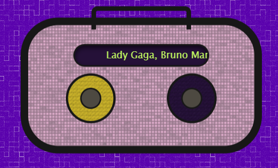
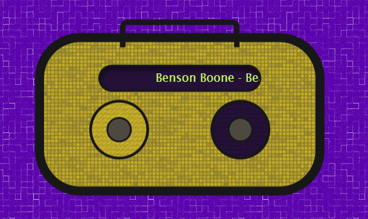

# little radio!
made a tiny pocket radio! :3 it plays random songs, has clickable knobs for play/pause and skipping tracks, and changes colors as the music plays.

## tech stack and made for 
built with html, css and javascript. i had fun making a bunch of divs look like an actual little device instead of just another rectangle on a screen :3 
- made for `#waffles!`

## requirements check

for the “three different ways to change the page” part, i change the content in three ways, first - to swap the song name on the radio’s display every time a new song loads, second - long song names slide across the screen instead of getting cut off, third and the most visible - changing the radio’s background color each time a new song starts and a css transition makes the color fade smoothly instead of snapping. the clicky part is the purple circle: every click loads a new song, a new name, and a new color, so the page keeps changing as you play with it :D
<table>
  <tr>
    <td></td>
    <td></td>
  </tr>
</table>

## credits
textures from [transparenttextures.com](https://www.transparenttextures.com/).